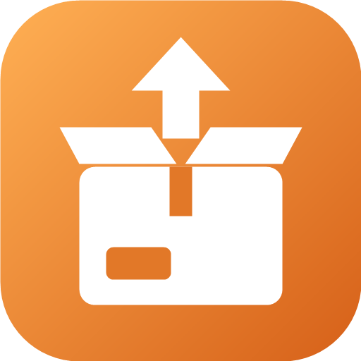
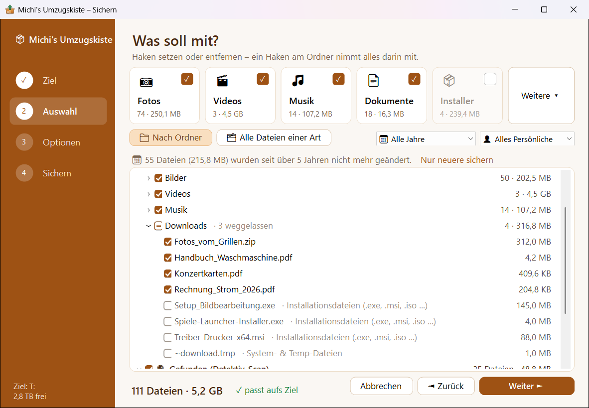
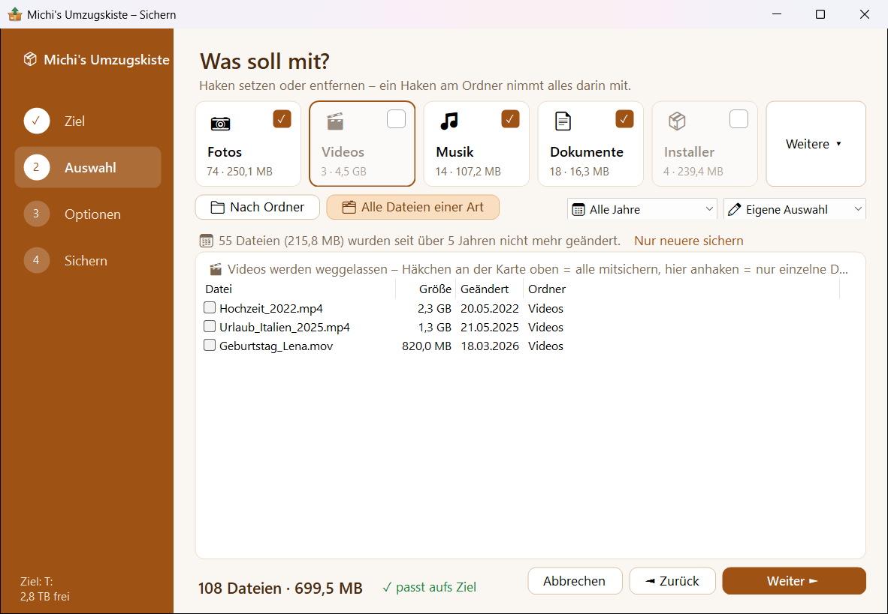
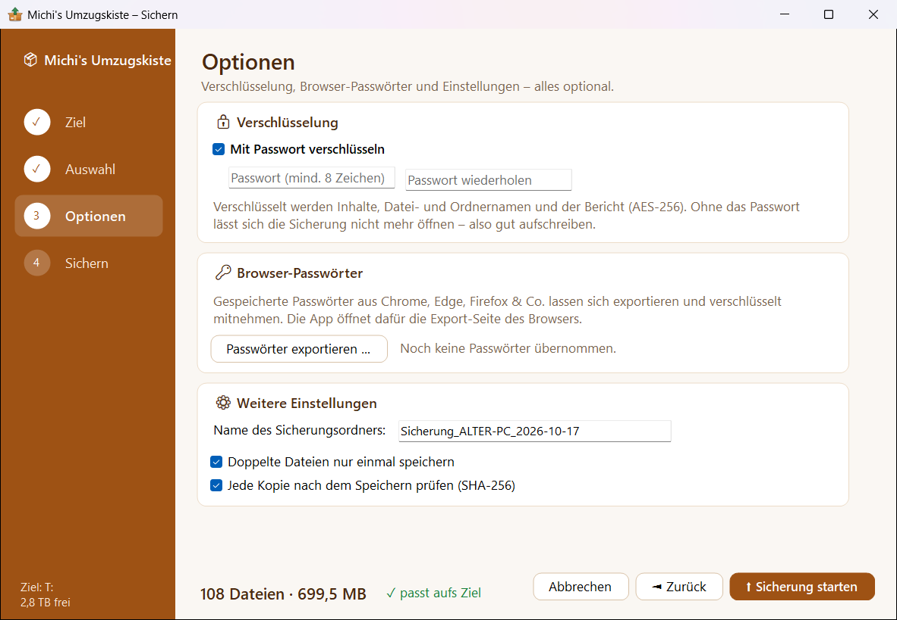

  

<h1 align="center">Michi's Umzugskiste</h1>

  <b>Umzug auf einen neuen PC, ohne etwas zu vergessen.</b> 
  Persönliche Daten finden, auf USB-Stick sichern und auf dem neuen PC wiederherstellen.

  

  <a href="#so-läuft-ein-umzug-ab">So geht's</a> ·
  <a href="#funktionen">Funktionen</a> ·
  <a href="#download">Download</a> ·
  <a href="#wichtig">Wichtig</a>

---

Wer umzieht, packt Kisten. Beim PC ist das nicht anders, nur sieht man nicht, was alles in den Schränken steckt: Fotos im Downloads-Ordner, Spielstände irgendwo in AppData, Lesezeichen, WLAN-Passwörter. **Die Umzugskiste sucht das alles zusammen**, packt es ordentlich ein und stellt es auf dem neuen PC wieder an seinen Platz. Eine EXE, keine Installation, kostenlos.

  

## So läuft ein Umzug ab

| 1️⃣ Alter PC | 2️⃣ Neuer PC | 3️⃣ Bericht |
|---|---|---|
| EXE starten, **Sichern** wählen und den vier Schritten folgen: Ziel (USB-Stick), Auswahl, Optionen, Sichern. | EXE vom Stick starten, **Wiederherstellen** wählen. Alles kommt zurück an seinen Platz. | „Bericht öffnen“ zeigt, welche Programme, Konten und Desktop-Verknüpfungen es auf dem alten PC gab. |

## Funktionen

**Finden und auswählen**
- 🔎 **Daten finden:** Dokumente, Bilder, Musik, Videos, Desktop und Downloads, Browser-Lesezeichen, Outlook- und Thunderbird-Daten, Spielstände, Schriftarten und Einstellungen von Programmen. Ein Suchlauf über alle Laufwerke findet auch Ordner mit eigenen Dateien außerhalb der üblichen Orte.
- ✅ **Schnellauswahl:** Nur das Wichtigste, Alles Persönliche oder Alles.
- 🗂️ **Karten für Fotos, Videos, Musik, Dokumente und Installer:** Ein Haken nimmt eine ganze Art rein oder raus, ein Klick auf die Karte zeigt alle Dateien dieser Art, die größten zuerst.
- 📁 **Nach Ordner:** Ein Haken am Ordner nimmt alles darin mit, einzelne Dateien lassen sich trotzdem dazunehmen oder weglassen. Was weggelassen wird, steht mit Grund daneben.
- 📅 **Altersfilter:** auf Wunsch nur Dateien der letzten Jahre sichern.

**Sicher sichern**
- 🔒 **Verschlüsselung** auf Wunsch mit Passwort (AES-256-GCM), auch für Datei- und Ordnernamen und den Bericht.
- ✔️ **Prüfung** jeder Kopie per SHA-256, doppelte Dateien werden nur einmal gespeichert.
- ⏯️ **Fortsetzen und Aktualisieren:** Bricht die Sicherung ab, geht es an derselben Stelle weiter. Liegt schon eine Sicherung dieses PCs auf dem Stick, kommen nur neue und geänderte Dateien dazu.
- 🔑 **Browser-Passwörter:** Chrome, Edge, Brave, Vivaldi, Opera und Firefox, verschlüsselt gesichert.

**Wiederherstellen**
- 📦 **Alles zurück an die passenden Orte** oder erst einmal in einen eigenen Ordner. Eine Vorschau zeigt vorher, was neu ist und was schon da ist. Schriftarten und WLAN werden direkt eingerichtet.
- 👀 **Ansehen ohne Wiederherstellen:** die Sicherung durchsuchen, einzelne Dateien öffnen oder herauskopieren, auch verschlüsselte.
- 🧾 **Programme & WLAN:** Liste der installierten Programme (mit winget auf dem neuen PC fast automatisch wieder installierbar), WLAN-Profile, Drucker, Netzlaufwerke und Outlook-Konten im Bericht.

**Außerdem**
- 🗑️ **Alte Daten vernichten:** nach der Sicherung auf Wunsch die Originale auf dem alten PC löschen, nach erneuter Prüfung jeder Kopie.
- 💼 **Portabel:** Die EXE kopiert sich mit auf den Stick, auf dem neuen PC einfach von dort starten.
- 🔄 **Updates mit einem Klick**, mit Prüfsummen-Check.

<b>Alle Details zum Sichern, Wiederherstellen und Vernichten</b>

- **Verschlüsselung:** AES-256-GCM, Schlüssel per PBKDF2 mit 600.000 Durchgängen. Verschlüsselt werden nicht nur die Inhalte, sondern auch Datei- und Ordnernamen und der Bericht: Auf dem Stick stehen nur neutrale Namen wie `daten\3f\8a1c….ukenc`. Ohne Passwort sieht man nur PC-Name, Datum, Anzahl und Größe.
- **Aktualisieren:** praktisch, wenn der alte PC bis zum Umzugstag weiterläuft.
- **Zeitschätzung:** Die App misst kurz das Tempo des Sticks und zeigt die voraussichtliche Dauer. Während der Sicherung geht der PC nicht in den Standby, der Fortschritt steht auch in der Taskleiste.
- **Stick sicher entfernen** direkt am Ende, ohne Umweg über Windows.
- **Nichts doppelt:** Beim Wiederherstellen werden vorhandene Dateien per Prüfsumme verglichen. Gleiche werden übersprungen, geänderte bleiben erhalten und die Version aus der Sicherung kommt daneben.
- **Gesperrte Dateien:** Läuft z. B. Outlook noch, fragt die App vor dem Start: Outlook schließen, als Administrator neu starten (dann wird über eine Schattenkopie gesichert) oder ohne diese Dateien weiter.
- **Verknüpfungen** und Steam-Starter vom Desktop werden nicht kopiert, sondern im Bericht aufgelistet. Nach dem Neuinstallieren legen die Programme sie ohnehin wieder an.
- **Browser-Passwörter:** Die App öffnet die Export-Seite des Browsers, findet die exportierte Datei, sichert sie verschlüsselt und löscht danach das unverschlüsselte Original.
- **Vernichten:** Auf Festplatten (HDD) wird überschrieben, auf SSDs und USB-Sticks gelöscht und mit TRIM freigegeben. Die App zeigt für jedes Laufwerk, was dort wirklich sicher ist.

<table>
  <tr>
    <td width="50%"></td>
    <td width="50%"></td>
  </tr>
  <tr>
    <td align="center">Alle Dateien einer Art: Videos abgewählt, einzelne trotzdem angehakt</td>
    <td align="center">Optionen: Verschlüsselung, Browser-Passwörter, Einstellungen</td>
  </tr>
</table>

## Download

| Datei | Größe | Hinweis |
|---|---|---|
| [`Michis-Umzugskiste.exe`](https://github.com/xviews/xviews-umzugskiste/releases/latest/download/Michis-Umzugskiste.exe) | ca. 50 MB | läuft sofort, keine Installation, kein .NET nötig, empfohlen |
| [`Michis-Umzugskiste-klein-benoetigt-dotnet10.exe`](https://github.com/xviews/xviews-umzugskiste/releases/latest/download/Michis-Umzugskiste-klein-benoetigt-dotnet10.exe) | unter 1 MB | braucht die [.NET 10 Desktop Runtime](https://dotnet.microsoft.com/download/dotnet/10.0), auch auf dem neuen PC |

**Voraussetzungen:** Windows 10 oder 11 (64 Bit). ➡️ Alle Versionen und Prüfsummen unter **[Releases](../../releases)**.

**Sicherheit:** Die Prüfsumme (SHA-256) jeder Version steht im Release-Text. Mit `Get-FileHash .\Michis-Umzugskiste.exe` in PowerShell kannst du sie selbst prüfen. Jede Version wird außerdem bei VirusTotal geprüft, die Ergebnisse stehen mit Link ebenfalls im Release-Text.

<b>Beim ersten Start</b>

- Meldet SmartScreen „Unbekannter Herausgeber“, auf **„Weitere Informationen“** und dann auf **„Trotzdem ausführen“** klicken. Die EXE ist nicht signiert, weil ein Zertifikat Geld kostet.
- Adminrechte sind nicht nötig. Nur wenn ein Programm wie Outlook Dateien sperrt, bietet die App den Neustart als Administrator an.

## Wichtig

- 🔑 Ein vergessenes Passwort lässt sich nicht zurückholen. Ohne Passwort sind verschlüsselte Sicherungen nicht mehr lesbar.
- ⚠️ Das Vernichten ist nur auf dem PC und mit dem Benutzer möglich, von dem die Sicherung stammt, und nur für Dateien, die seit der Sicherung unverändert sind.
- Nutzung auf eigene Verantwortung. Wichtige Daten am besten zusätzlich an einem zweiten Ort aufbewahren.
- 🚫 Das Tool sammelt keine Daten und schickt nichts an mich.

<b>Wann die App ins Internet geht</b>

- **Update-Suche:** Die öffentliche Release-Seite auf GitHub wird höchstens einmal am Tag abgefragt. Im Startfenster abschaltbar („automatisch“), dann nur noch auf Knopfdruck.
- Wenn du selbst etwas anstößt, zum Beispiel ein Update installierst oder die Programme mit winget neu installierst.

## Fehler melden

Fehler und Wünsche gerne unter **[Issues](../../issues/new/choose)**, am besten mit Screenshot und Windows-Version. Bei einem Absturz hilft die Datei `UmzugsKiste-Fehler.log` aus dem Ordner `%TEMP%`.

## Nutzungsbedingungen

Michi's Umzugskiste ist **kostenlos für die private Nutzung**. Die unveränderte Weitergabe der Programmdatei ist erlaubt.

Was nicht erlaubt ist, und verwendete Komponenten

Nicht gestattet sind: der Verkauf, das Verändern des Programms, das Zurückentwickeln (Dekompilieren, Disassemblieren), die Übernahme von Programmcode oder Teilen davon in andere Software sowie das Einspeisen des Programms oder seines Codes in KI-Systeme, um es zu analysieren oder nachzubauen.

© 2026 Xviews. Alle Rechte vorbehalten.

**Verwendete Komponenten**

- [.NET / Windows Forms](https://github.com/dotnet/winforms), MIT-Lizenz
- [System.Management](https://www.nuget.org/packages/System.Management), MIT-Lizenz
- [winget](https://github.com/microsoft/winget-cli) (Teil von Windows) für die Liste und die Neuinstallation von Programmen

